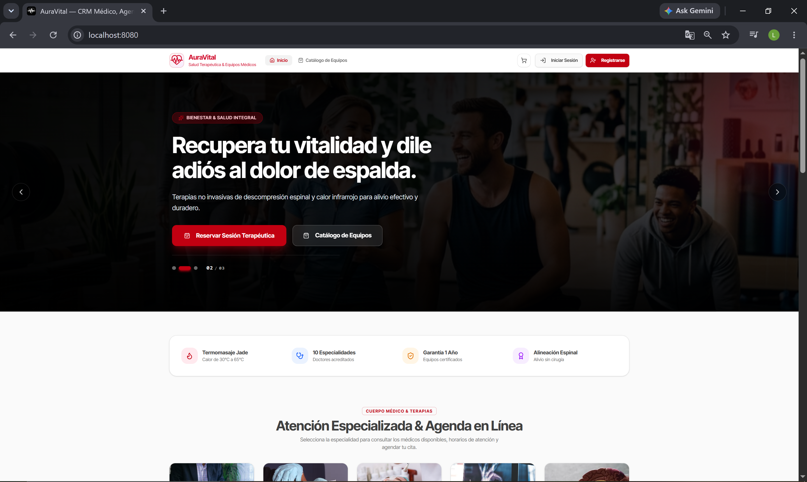
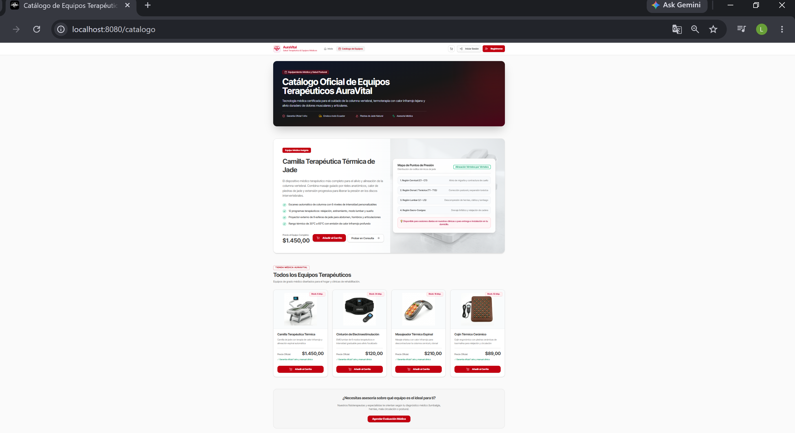
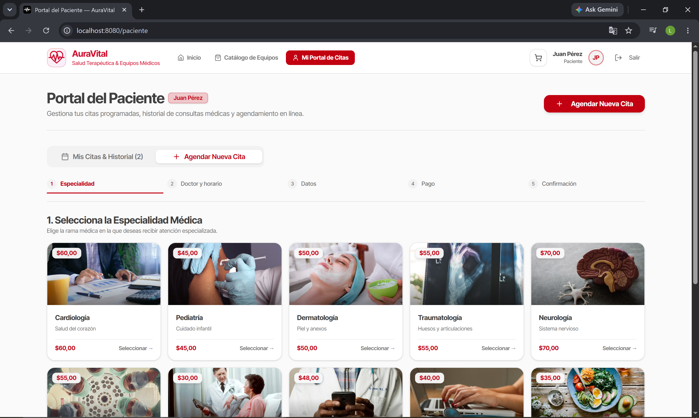
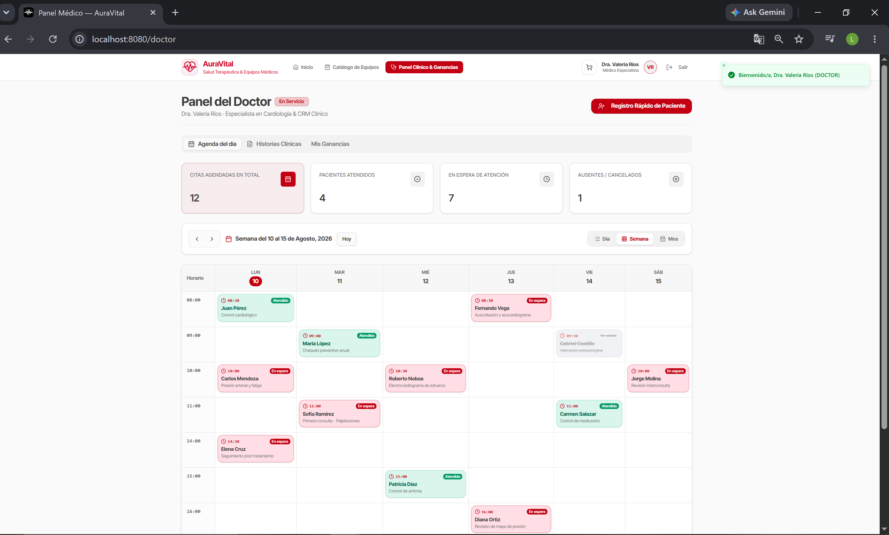
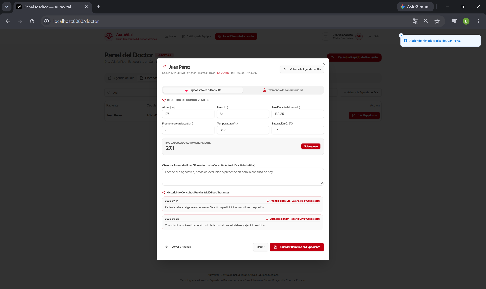
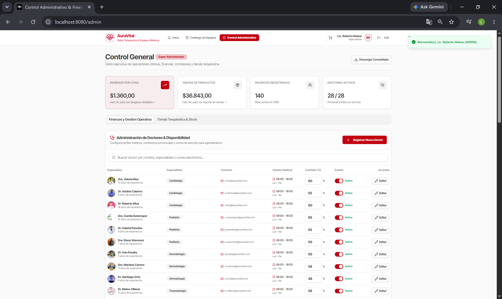

# 🩺 AuraVital — CRM Médico & E-Commerce de Salud Terapéutica

> Plataforma integral de gestión médica y comercio electrónico diseñada para clínicas de salud integral, tratamientos de medicina alternativa y especialidades médicas.

<p align="center">
  <a href="https://auravital.vercel.app/" target="_blank">
    
  </a>
</p>

<p align="center">
  
</p>

---

## 🎓 Propósito Académico & Prototipado

Este proyecto ha sido desarrollado con **fines estrictamente académicos, de demostración técnica y aprendizaje tecnológico**. 

- **Demostración de Arquitectura Software:** Sirve como un prototipo funcional para la validación de experiencia de usuario (UX/UI), modelado de datos de salud y flujos de trabajo en sistemas médicos y e-commerce.
- **Datos Simulados (Mock Data):** Toda la información de pacientes, historias clínicas, diagnósticos, valores de laboratorio y registros financieros son completamente ficticios y utilizados únicamente para simular escenarios reales de un entorno clínico.
- **Exención de Responsabilidad:** No está destinado a reemplazar sistemas de gestión médica reales ni a ser utilizado con datos médicos confidenciales sin la debida integración de normativas de seguridad (HIPAA / GDPR).

---

## 🌟 Características Principales & Vistas del Sistema

### 🌐 1. Vista Pública & Landing Page
- **Hero Section Dinámico:** Presentación de valor con imágenes médicas y navegación limpia.
- **La Ciencia Detrás:** Explicación técnica de tratamientos (*Termoterapia, Escaneo Espinal, Acupresión y EMS*).
- **Agenda en Línea:** Catálogo fotográfico de especialidades médicas con agendamiento directo.

### 🛒 2. E-Commerce & Catálogo Terapéutico
- **Vista Dedicada (`/catalogo`):** Catálogo oficial de productos de grado médico (Camilla Térmica de Jade, Cinturón EMS, Masajeador Espinal, Cojín Cerámico) con fichas técnicas y rangos térmicos.

<p align="center">
  
</p>

### 👤 3. Portal del Paciente & Wizard de Agendamiento
- **Wizard de Agendamiento (5 pasos):** Selección de especialidad, elección de doctor en tiempo real, formulario, pasarela simulada y confirmación.

<p align="center">
  
</p>

### 🩺 4. Panel del Doctor & Historia Clínica
- **Calendario en Cuadrícula:** Conmutador para planificación por Día, Semana y Mes.
- **Historia Clínica Digital:** Registro completo de Signos Vitales, cálculo automático de IMC y expediente de consultas previas.

<p align="center">
  
  
</p>

### 🛡️ 5. Control General (Super Administrador)
- **Dashboard Ejecutivo & Finanzas:** Métricas globales, desglose modal de ingresos por citas (comisión clínica vs doctor) y gestión de turnos de médicos.

<p align="center">
  
</p>

---

## 🛠️ Tecnologías Utilizadas

- **Frontend:** React + TypeScript (Vite)
- **UI & Estilos:** Tailwind CSS + Radix UI / shadcn/ui
- **Iconos & Gráficos:** Lucide React + Recharts
- **Router & Estado:** React Router / TanStack Router + AuthContext

---

## 🚀 Instalación y Configuración Local

1. **Clonar el repositorio:**
   ```bash
   git clone [https://github.com/luisAristeguieta/auravital-crm.git](https://github.com/luisAristeguieta/auravital-crm.git)
   cd auravital-crm
```
2. **Instalar dependencias:**
   ```bash
   npm install
```
3. **Iniciar el servidor:**
   ```bash
   npm run dev
```